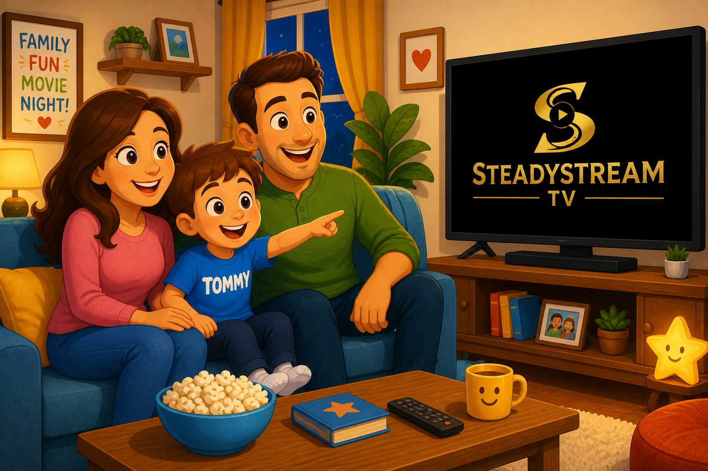

# Tommy's TiviMate Adventure
## A SteadyStream TV Children's Picture Book



---

## 📚 About This Book

This is a **children's picture book** designed to teach kids how to use the TiviMate IPTV player application, branded with **SteadyStream TV** identity.

The book features:
- ✅ Simple, child-friendly instructions
- ✅ Colorful, engaging illustrations
- ✅ Step-by-step guide to TiviMate controls
- ✅ Safety reminders and parental guidance
- ✅ Interactive HTML version for digital viewing
- ✅ Print-friendly format

---

## 🎯 Purpose

This educational picture book helps:
- **Children** learn to navigate TiviMate independently
- **Parents** teach their kids responsible TV usage
- **Families** establish safe viewing habits together
- **SteadyStream TV** provide value-added customer resources

---

## 📖 Contents

### Main Story (16 Pages):
1. Meet Tommy and SteadyStream
2. The Magic Remote
3. Starting TiviMate
4. Finding Your Favorite Channels
5. The Channel List
6. Watching Your Show
7. The Program Guide (EPG)
8. Fast Forward and Rewind
9. The Search Feature
10. The Favorites Star
11. Volume Control
12. The Settings Menu
13. Turning Everything Off
14. Tommy Becomes a TiviMate Expert!
15. Safety Reminders
16. The End - Happy Streaming!

### Additional Content:
- Parent's Quick Reference Guide
- Safety Tips for Children
- TiviMate Controls Overview

---

## 📁 Files Included

```
childrens-book/
├── README.md                               # This file
├── tivimate-guide.md                       # Full text content (markdown)
├── index.html                              # Interactive web version
├── page-01-tommy-and-steadystream.png      # Page 1 illustration
├── page-02-magic-remote.png                # Page 2 illustration
├── page-04-channel-list.png                # Page 4 illustration
├── page-08-time-controls.png               # Page 8 illustration
├── page-09-search-feature.png              # Page 9 illustration
├── page-10-favorites-star.png              # Page 10 illustration
├── page-14-tommy-expert.png                # Page 14 illustration
└── page-16-happy-ending.png                # Page 16 illustration
```

---

## 🌐 How to View

### Option 1: Interactive HTML Version
1. Open `index.html` in any web browser
2. Scroll through the pages
3. Click the "Print Book" button to create a PDF

### Option 2: Markdown Version
1. Open `tivimate-guide.md` in any markdown viewer
2. Read the full text content

### Option 3: Print Version
1. Open `index.html` in a browser
2. Click "Print Book" button or use Ctrl+P / Cmd+P
3. Save as PDF or print directly
4. Recommended: Print in color for best results

---

## 🎨 Design Features

### Branding:
- **Primary Color**: Gold (#FFD700) - SteadyStream signature color
- **Secondary Colors**: Black, white, and vibrant accent colors
- **Typography**: Child-friendly, rounded fonts
- **Tone**: Warm, encouraging, educational

### Illustrations:
- Cartoon-style, kid-appropriate artwork
- Clear, simple visual explanations
- Consistent character design (Tommy)
- Bright, engaging colors

### Layout:
- Large, readable text
- Clear section breaks
- Highlighted important information
- Parent's guide section included

---

## 👨‍👩‍👧‍👦 Target Audience

**Primary**: Children ages 5-10 years old

**Secondary**: Parents and guardians teaching their children

**Reading Level**: Early elementary (with parent guidance)

---

## 🛡️ Safety & Responsibility

This book emphasizes:
- Always asking permission before watching TV
- Setting time limits
- Asking adults for help when needed
- Proper volume levels
- Safe viewing distances
- Never changing settings without permission

**Parent's Guide** included for additional supervision tips.

---

## 📝 TiviMate Controls Covered

### Basic Navigation:
- Arrow keys (Up, Down, Left, Right)
- OK/Select button
- Back button
- Home button

### Advanced Features:
- Program Guide (EPG)
- Search functionality
- Favorites/Star marking
- Volume controls
- Time controls (for recordings)
- Settings (with parent supervision)

---

## 💡 Usage Tips

### For Parents:
1. Read through the book with your child first
2. Demonstrate each control as you explain it
3. Let your child practice with supervision
4. Establish clear family TV rules
5. Enable parental controls in TiviMate
6. Set viewing time limits

### For Educators:
- Use as a digital literacy teaching tool
- Demonstrate technology responsibility
- Teach children to follow multi-step instructions

---

## 🔧 Technical Information

**TiviMate Compatibility:**
- TiviMate IPTV Player (all versions)
- Works with standard remote controls
- Android TV devices
- Fire TV devices
- Any device running TiviMate

**SteadyStream Integration:**
- Branded throughout the book
- Logo and color scheme integration
- References SteadyStream TV service
- Can be customized for other IPTV services

---

## 📱 Distribution Options

### Digital:
- Email to customers as PDF
- Download from SteadyStream website
- Send as onboarding material
- Share via customer portal

### Print:
- Physical booklets for new subscribers
- Promotional handouts
- Welcome package inclusion
- Customer support resource

### Online:
- Host on SteadyStream website
- Interactive web version
- Blog post or help article
- Social media sharing

---

## 🎁 Customer Value

This book provides:
- ✅ **Reduced support calls** - Families can self-train
- ✅ **Enhanced customer experience** - Value-added resource
- ✅ **Family-friendly branding** - Shows care for all users
- ✅ **Educational content** - Promotes responsible usage
- ✅ **Professional presentation** - Elevates brand image

---

## ⚖️ Legal & Compliance

**Educational Use**: This book is designed for educational purposes to teach children how to use TiviMate software.

**Parental Guidance**: Adult supervision is recommended throughout.

**Content Responsibility**: Parents are responsible for enabling appropriate parental controls and monitoring viewing content.

**TiviMate**: TiviMate is a third-party IPTV player application. This book explains its basic functionality.

**SteadyStream Branding**: All SteadyStream TV branding and logos are property of their respective owners.

---

## 🔄 Customization

This book can be easily customized:
- Replace "SteadyStream TV" with your brand name
- Update colors to match your brand
- Add your logo to pages
- Modify content for different IPTV players
- Translate to other languages

---

## 📧 Support

For questions about using this book or SteadyStream TV service:
- Visit SteadyStream TV website
- Contact 24/7 customer support
- Email customer service

---

## 🌟 About SteadyStream TV

**SteadyStream TV** provides:
- Premium IPTV streaming service
- 10,000+ channels
- Full HD & 4K quality
- 24/7 customer support
- Multiple device compatibility
- Affordable subscription plans

*Where Every Show is an Adventure!* ⭐📺✨

---

## 📄 License

This children's picture book is provided as a customer resource and educational material for SteadyStream TV subscribers.

© 2026 SteadyStream TV. All rights reserved.

---

**Made with ❤️ for families who love watching TV together!**
